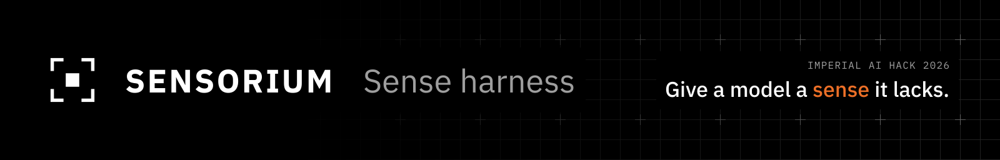

# Sensorium

<p align="center">
  
</p>

<p align="center">
  <strong>An agent that gives a model a sense it doesn't have, proves the sense works, and installs it. If the proof fails, it refuses.</strong>
</p>

_This project was built at Imperial AI Hack 2026 for the Autonomous Agents track. For the submission, see [docs/devpost.md](docs/devpost.md)._

---

You give Sensorium a model and a file that model cannot read: a 3D mesh, a video clip, a molecule, a sound, or a format nobody wired in. You also say what you want to know ("what object is this?"). The agent works out what the file is and builds a way to get it into the model. It then finds labelled examples on the web and tests the result against controls. It installs the new sense only if the test passes. Otherwise it installs nothing and shows you the numbers that stopped it.

## How a run works

1. **Detect.** The agent reads the file's bytes, never its name: audio, image, video, 3D, molecule, coordinates, text, or unknown. If the model already reads the file, the run ends there.
2. **Build a bridge.** For audio, it fits a map from a frozen audio encoder (CLAP) into an open-weight model's early layers, or gives the model the encoder's output as text or as a tool it can call. For anything else it writes an **adapter**: Python code that turns the file into text or images the model can read. The code runs in a sandbox with no network. A package outside the approved toolbox (`mido`, in the blind test below) is installed only after the installer has vetted it and you have approved it.
3. **Find probe data.** It searches the Hugging Face Hub and the web (Linkup) for labelled examples and, for an adapter, a second set whose categories the adapter was not built around. If nothing usable turns up, it asks you for a folder of examples.
4. **Verify.** The frozen model answers held-out multiple-choice questions through the bridge, and its score is compared with controls: the same questions asked with another file's input (swapped input), with no file at all, the model reading the raw file, and unseen categories.
5. **Install or refuse.** Fixed rules in `agent/planner.py` decide, never a language model. After an install, chat sends matching files through the new sense, and each reply names the sense that carried the file.

## Results

Every number below comes from a recorded run in [`socket_pilot/artifacts/`](socket_pilot/README.md). Questions have five options (chance 20%) unless the label set is smaller. Brackets are 95% Wilson intervals. Each row is a single run.

| File and goal | Base model | Labelled data | Score | The control that mattered | Outcome |
|---|---|---|---|---|---|
| music clip, "recognise music genres" | Qwen3.5-0.8B | GTZAN (pre-wired; the web fetch failed) | 79.5% [73.4, 84.5] | swapped input 12.5% | installed |
| any sound | Qwen3.5-0.8B | ESC-50 | 96.5% | 51.25% on sounds left out of fitting | refused; a caption bridge at 80.5% [74.5, 85.4] was installed instead |
| 3D mesh, "what object is this" | Claude Sonnet 5.5 | ModelNet40, found by the agent | 100.0% [92.9, 100] | raw file 42%, unseen categories 64% | installed |
| video, "what action" | Claude Sonnet 5.5 | HMDB51, found by the agent | 78.0% [64.8, 87.3] | no input 20%, unseen actions 92% | installed |
| molecule, "what does it smell like" | Claude Sonnet 5.5 | an odour dataset, found by the agent | 58.0% [44.2, 70.6] | raw SMILES 46% | installed, 12 points over the raw file |
| coordinates, "which country" | Claude Sonnet 5.5 | world cities, found by the agent | 100.0% | raw coordinates 98% | refused: the model already reads coordinates |
| MIDI, "what genre" (blind test) | Claude Sonnet 5.5 | 60 piano MIDI files we supplied | 32.0% [20.8, 45.8] | no input 20% | refused: below the 35% bar |

The 3D run was repeated once, from an empty sense folder, and installed again at 100.0% (swapped input 8%, raw file 34%, unseen categories 70%). The ESC-50 run turned down its best-scoring bridge because that score did not hold on sounds the bridge had never been fitted on. In the blind test, MIDI appears nowhere in the code. The agent wrote a working `mido` adapter on its first attempt. The only MIDI genre set its Hub search returned was one it could not read, so it asked for examples. With our examples it measured a weak adapter and refused it.

## Try it

`uv sync` installs everything. Fake mode needs no weights, keys or network:

```bash
SENSE_FAKE=1 .venv/bin/python -m pytest -q                                # the test suite
SENSE_FAKE=1 .venv/bin/python -m uvicorn server.app:app --port 8000       # then open http://127.0.0.1:8000
```

A real run needs an API key in `.env`: `OPENAI_API_KEY` or `ANTHROPIC_API_KEY` for the agent's LLM, and `LINKUP_API_KEY` for web search. A local Qwen3.5 model also needs its weights; `.venv/bin/python scripts/setup_machine.py check` lists what is missing. Then press **New sense** in the interface, drop a file and type a goal, or use the command line:

```bash
.venv/bin/python -m agent --model claude-sonnet --file chair.glb --goal "What object is this?"
.venv/bin/python -m agent --model qwen3.5-0.8b --file clip.wav --goal "Make it recognise music genres" --examples <folder>
```

Install requests are asked on the terminal, and No is the default.

## Limits

- **Single runs.** Adapters are rewritten on every run, so a number can move: the molecule adapter cleared the raw-file bar in one run and missed it by 2 points in another.
- **A pass is not understanding.** It shows that the model answers better with the adapter than without it, on that data.
- **Small samples for API models.** They are scored on 50 questions, so intervals span about 12 points either way.
- **The specialist is often enough.** On ESC-50, CLAP alone scores 99.0%. On GTZAN, nearest-example lookup scores 84.5% against the bridge's 79.5%.
- **No labelled data, no sense.** Without examples the agent can find or you supply, it stops and says which examples it needs.
- **Imperfect unseen sets.** The video run's unseen actions come from another upload of the same corpus. The molecule run found no second source, so its unseen control was not measured.

The full list is in the [reference](docs/reference.md#known-limits).

## More

- [docs/reference.md](docs/reference.md): setup and every setting, each step of a run, the acceptance rules, all measured results, the forest-monitoring triage task, Databricks, and the repository layout.
- [socket_pilot/README.md](socket_pilot/README.md): the research scripts and a description of every recorded run.
- [docs/devpost.md](docs/devpost.md): the submission. [docs/plan.md](docs/plan.md): the plan from 14 November.

Built by Yuyao (lead; data platform, demo, submission), Michael (harness and verification), Jayden (agent autonomy) and Alex (interface and design). The team coordinates on a pinned GitHub issue with `tools/board`; see [AGENTS.md](AGENTS.md).
