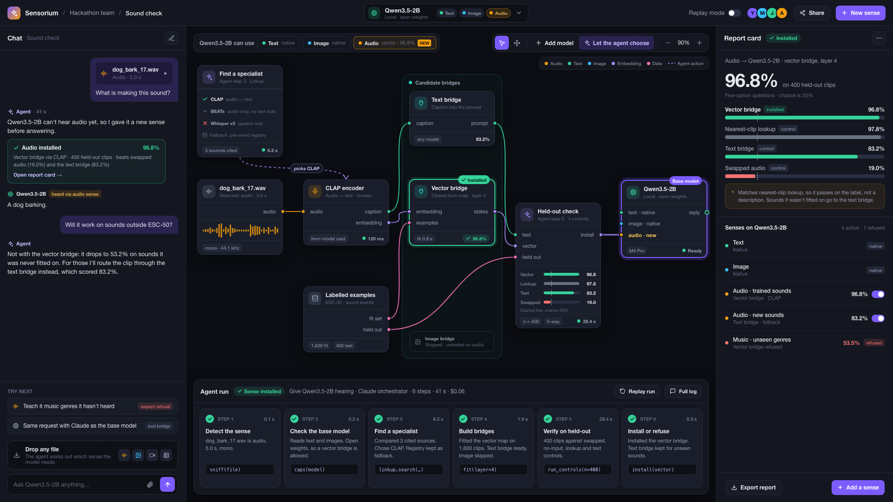

# Design

Interface mockups and diagrams for the plan in `docs/plan.md` (PR #5). Design only, no application code.

## Main screen: Sensorium



- **Figma (editable layers):** [ML Model Composer UI, frame "v2 – Sensorium"](https://www.figma.com/design/a0FtNU8c2u9zzTg2FwCALb?node-id=9-2). It lives in Yuyao's Figma drafts, so ask for edit access.
- **Source:** `sensorium/gen.py` writes `sensorium/sensorium.html`, which was converted into the Figma frame.

The screen shows one finished agent run, scenario 1 in the plan, with Qwen3.5-2B given hearing:

| Area | What it shows |
|---|---|
| Top bar | Base model picker with the senses the model has (text, image, new audio), replay mode |
| Chat (left) | File drop, the agent explaining the install, the model answering through its new sense, suggested next scenarios |
| Sense graph (centre) | File → specialist chosen by the agent → candidate bridges → held-out check → base model |
| Agent run (bottom) | The six steps of the agent loop with timings and the code each one runs |
| Report card (right) | Accuracy against the controls and the chance line, and the senses installed or refused on this model |

**Placeholders:** the name "Sensorium", step timings and the run cost. The accuracy figures come from the pilot (`socket_pilot/README.md`) but mix runs (for example, the 83.2% text bridge figure is from Qwen3.5-0.8B on unseen sounds), so replace them with one consistent run before the demo.

### Regenerate

```bash
python3 design/sensorium/gen.py design/sensorium/sensorium.html
```

Edit the `NODES` and `WIRES` tables in `gen.py` to change the graph; wire positions are computed from the port rows, so they stay attached.

## Agent board diagrams

[FigJam board](https://www.figma.com/board/h4QH1HxGr6nJzTqLALwkfv) with three diagrams of how the team's agent board works. Mermaid sources are in `board-diagrams.md`.
