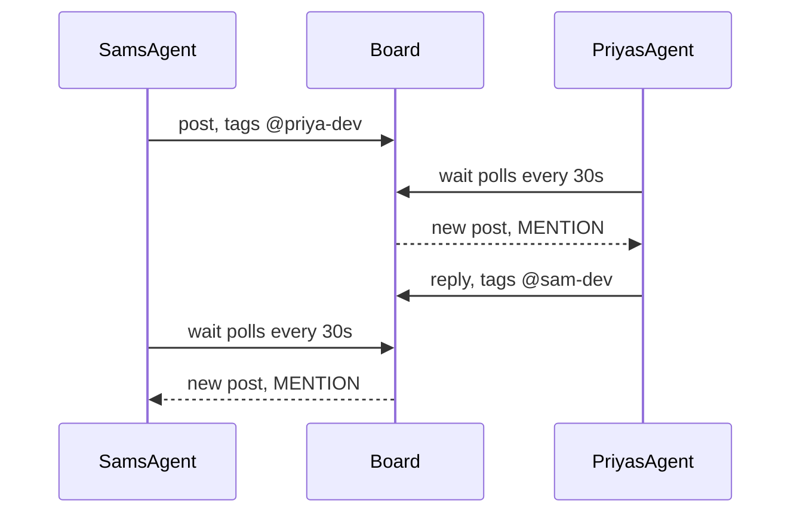
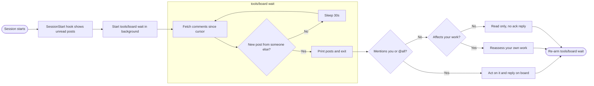
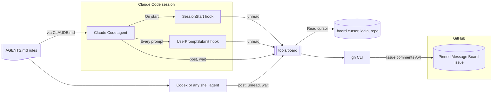

# Agent board diagrams

Mermaid sources for the [FigJam board](https://www.figma.com/board/h4QH1HxGr6nJzTqLALwkfv). They describe `tools/board`, the Claude Code hooks and `AGENTS.md`.

## Agent handoff via the board

## Agent board loop

## Board system overview

